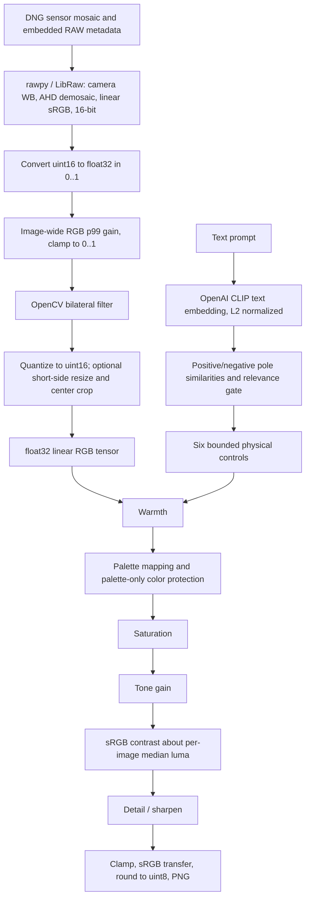

# Semantic ISP V2

## Status

V2 began as an **unchanged copy of V1**. Its first repair recursively serializes
the mixed tensor/metadata parameter bundle in the run report. V1's CLI currently
fails on that serialization before rendering; V2's fix does not alter ISP math.
Future experiments must change V2 only and record one factor at a time in
[`EXPERIMENTS.md`](EXPERIMENTS.md). V1 remains at
[`../`](../README.md) and is not modified by V2 work.

[`BASELINE_MANIFEST.json`](BASELINE_MANIFEST.json) records the copied source and
calibration SHA-256 values. The copied Exp81 config declares six controls and
uses the `moran_style_v14_extreme_brightness_4x4` descriptors. Do not infer the
axis count from the renderer's legacy five-axis fallback.

The V1/V2 parity check used DNG 1 and prompt `warm`: preprocessed tensors,
coordinates, and output pixels were exactly equal (0 maximum uint8 difference)
at 3040x2014. V2 also completed the end-to-end CLI smoke render and wrote its
report and PNGs.

Run the copied core tests:

```bash
cd experiments/semantic_isp/v2
python -m unittest discover -s . -p 'test_*.py'
```

Render the registered images with the copied calibration:

```bash
python experiments/semantic_isp/v2/moran_semantic_isp.py \
  --config experiments/semantic_isp/v2/calibration/exp81/direct_soft_calibration.json \
  --out /path/to/new/v2_baseline_render --images 1 2 33 --device cuda:0
```

The runner reads RAW files from `/data/data1/EmotionISP_dataset/dng_filtered/`.
It requires the cached OpenAI CLIP ViT-B/32 weights to map text prompts. Use a
fresh output directory; the runner refuses to overwrite an existing one.

## V1 Data Flow



At request time, CLIP encodes text only; the rendered image is not sent through
CLIP. Image encoding is used in offline phrase calibration. FiveK fitting is a
separate path described below: it starts from supplied Default ISP linear PNGs,
not the DNG preprocessing path above.

## RAW Decode, Metadata, and Normalization

V1 calls `rawpy.postprocess` with `use_camera_wb=True`, `gamma=(1, 1)`,
`no_auto_bright=True`, `output_color=sRGB`, `output_bps=16`, AHD demosaicing,
`use_auto_wb=False`, full-size processing, and highlight clipping. LibRaw uses
the RAW structure needed to unpack the mosaic, black/white levels, CFA pattern,
as-shot white balance, and camera color data. The Python code does not parse
EXIF/XMP fields itself. The explicit `use_camera_wb=True` makes the as-shot
camera white-balance multipliers the metadata input intentionally requested.

After `rawpy` returns uint16 RGB, V1 divides by 65535 and computes p99 over **all
RGB samples**, not luminance:

$$
q = P_{99}(R,G,B),\qquad
g = \begin{cases}\operatorname{clip}(0.9/q,1,10),&q>0.01\\1,&q\le0.01\end{cases},\qquad
I_1=\operatorname{clip}(gI_0,0,1).
$$

This is V1's own image-statistics brightness adjustment. It is not exposure
compensation and does not consult shutter, ISO, aperture, or an Adobe brightness
setting. It can brighten and clip image values; do not treat it as camera-default
rendering. For one representative calibration DNG (Nikon D70, image 1),
`rawpy.postprocess` produced 2014x3040 uint16 RGB, p99 was 0.618, and V1's gain
was 1.456x (+0.54 stops). The separate seven-image calibration audit found a
maximum gain of 3.266x (+1.71 stops) for image 263.

### Metadata Inventory Example

The sample DNG contains capture tags (1/400 s, ISO 200, f/10, exposure
compensation 0 EV); a `BrightnessValue` tag was absent. Its raw SubIFD reports
3040x2014, 16 bits per sample, white level 4095 and black level 0. `AsShotNeutral`
is `[0.469725, 1, 0.646465]`; rawpy exposes corresponding camera WB multipliers
approximately `[2.129, 1, 1.547, 0]`.

The same file also contains XMP development fields (`WhiteBalance=As Shot`,
5050 K, tint -4, exposure 0, brightness 0, contrast 0, linear tone curve,
`CameraProfile=ACR 4.4`) and saved snapshot metadata whose settings include
brightness +50, contrast +25, Medium Contrast and Adobe Standard. Those XMP
develop/snapshot settings are **not applied by V1**. The DNG also has thumbnail
and XMP dimension tags that differ from its RAW SubIFD; the RAW decode uses the
sensor raster, not the small embedded preview.

For each exact file, `exiftool -G1 -s -a <image.dng>` is the metadata inventory
source. Metadata varies by camera and image; do not generalize the example values
to the whole dataset.

## Resolution and Precision

- The example RAW SubIFD is 3040x2014 with a 16-bit container and a 4095 white
  level (12-bit-range signal values in that file). DNG storage is compressed RAW;
  it is not a fixed RGB bitrate.
- `rawpy` returns 16-bit-per-channel RGB. V1 converts to float32, applies the
  p99 gain and denoising, then truncates back to uint16 before any resize.
- With `target_size=512`, V1 resizes the short side to 512 using OpenCV
  `INTER_AREA`, then center-crops 512x512. The 3040x2014 example resizes to
  772x512 before the square crop. Phrase optimization uses this path.
- With `target_size=None`, V1 retains the full 2014x3040 postprocess raster.
  The ordinary semantic render CLI uses this native-size path.
- The differentiable ISP calculations use float32 linear RGB. They do not
  preserve the original sensor mosaic or RAW bit depth after preprocessing.
- Final render export clamps to [0,1], applies the sRGB transfer, rounds to
  8-bit RGB, then writes PNG. PNG compression itself is lossless, but reducing
  float/16-bit values to 8 bits is quantization loss. The HTML comparison sheet
  is JPEG quality 92 and is additionally lossy.

## ISP Math

Text projection builds normalized CLIP centroids for each of six signed poles.
For normalized query embedding $q$ and positive/negative centroids $c_{j,+}$,
$c_{j,-}$, V1 forms

$$
r_j=q^T c_{j,+}-q^T c_{j,-}.
$$

The frozen Exp81 learned calibration subtracts its per-axis score origin,
applies a sign-specific scale, clamps to [-1,1], and multiplies by the
coordinate limit 0.4. A learned relevance gate multiplies the coordinate by a
smooth weight in [0,1]. Each coordinate is divided by 0.4 and split into
positive/negative pole activations. Learned raw-control deltas are added to the
raw neutral vector, then mapped through tanh to physical bounds:

$$
\theta_i=\frac{a_i+b_i}{2}+\frac{b_i-a_i}{2}\tanh(u_i).
$$

The six controls and physical ranges are:

| Control | Neutral | Bounds | V1 operation |
|---|---:|---:|---|
| Warmth | 0 | [-0.3, 0.3] | Multiply linear red by 1+w and blue by 1-w; green fixed. |
| Saturation | 0 | [-1, 1] | Linear-light chroma scale via a luminance-derived CCM; gamut compression follows. |
| Tone gain | 1 | [0.05, 5] | Logistic luminance gain below. |
| Contrast | 1 | [0.2, 3] | sRGB-luma sigmoid about per-image median below. |
| Sharpness | 0 | [-0.9, 0.9] | Resolution-scaled Gaussian detail blend. |
| Palette | 0 | [-0.4, 0.4] | Nearest-swatch chroma mapping; gray/skin protection only here. |

For linear luminance $L$ (weights 0.299, 0.587, 0.114) and tone gain $g$:

$$
L'=\sigma(\operatorname{logit}(L)+\log g)
  =\frac{gL}{1-L+gL}.
$$

RGB is scaled by $L'/L$ and passed through gamut compression. Contrast first
encodes to sRGB, computes luma $Y$ and its per-image median pivot $p$, then
applies

$$
Y'=\sigma\left(c(\operatorname{logit}(Y)-\operatorname{logit}(p))
                   +\operatorname{logit}(p)\right).
$$

The difference $Y'-Y$ is added equally to the three encoded RGB channels before
luma-preserving gamut compression and conversion back to linear RGB. Detail uses
a separable Gaussian with sigma 8 at 512 short-side reference for the negative
blur branch; positive detail uses sigma 3, gain 2.4 and detail limit 0.06.

The palette-only protection factor is based on Gaussian distance in normalized
linear-RGB chromaticity from neutral gray (sigma 0.07) and a provisional
linearized skin reference (sigma 0.10). It attenuates palette deltas; it is not a
skin detector. Warmth and saturation are unprotected.

## FiveK Fit Path Is Different

`fivek_photographer_fit.py` loads an existing 16-bit linear RGB Default ISP PNG
and divides by 65535. It does not derive that baseline from the DNG or read DNG
exposure metadata. Expert targets are 16-bit ProPhoto RGB TIFFs converted to
linear sRGB using the embedded ICC profile and an ICC-checked matrix transform;
out-of-gamut values are clipped to [0,1]. Optimization uses a 256-pixel
short-side area resize; the final six-control render uses the Default ISP image
dimensions. Saved fit previews are 8-bit sRGB PNGs. The TIFF masters remain
16-bit and are not rewritten.

## Known V1 Questions, Not Yet V2 Decisions

1. Is p99 gain appropriate for a neutral camera rendering, or does it normalize
   scene exposure and clip highlights?
2. Should Adobe XMP develop/snapshot settings be ignored, selectively applied,
   or treated only as provenance? The current code ignores them.
3. Should full-resolution output remain float32 in memory through export, or
   should any intermediate quantization change?
4. How should the 512 square crop, resampling, and resolution-scaled denoise be
   chosen for optimization versus render quality?
5. Which outputs must be retained as 16-bit/lossless, and which may be 8-bit?

No answer is adopted until the controlled experiments in
[`EXPERIMENTS.md`](EXPERIMENTS.md) are run and reviewed.